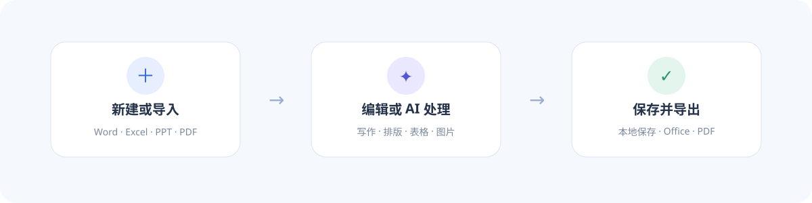

# Nexdo

**Nexdo 是一款完全由 AI 操控的免费开源办公软件。**

作者：alphA0099/GHOST CLAW

当前版本：**1.3.0**　

适用平台：**Windows x64**　

技术栈：**Tauri + Vue + Rust**

Nexdo 支持本地文档编辑、Office/WPS 文件兼容、网页浏览与资料下载，并通过 **Nexdo AI** 直接完成写作、排版、表格整理、图片插入和文档管理。


## 安装与快速开始

1. 直接打开 `nexdo.exe`，或运行 `Nexdo_1.3.0_x64-setup.exe` 完成安装。
2. 在欢迎页点击 **开始**，新建空白 Word 文档。
3. 也可以打开 **文件**，新建 Word、Excel、PPT，或导入已有 Office、WPS、PDF 文件。
4. 编辑完成后按 **Ctrl + S** 保存；需要其他格式时选择 **文件 → 导出**。
5. 在 **设置 → 默认保存位置** 中可统一管理保存、导出、格式转换和浏览器下载目录。

## 1.3.0 更新内容

- **DOCX 往返保真**：Nexdo 生成的 DOCX 再导入时，可恢复原始内容、文字与段落样式、表格、图片、页眉页脚和页面设置；标准 DOCX 中也保留常用 Office 样式。
- **完整历史记录**：Word、Excel、PPT 均支持最近 **20 步**撤销与重做，覆盖文字颜色、底纹、页面设计和内容编辑等操作。
- **空白页管理**：插入的空白页可跨分页与保存保留，在空白页顶端按 **Backspace** 删除，按 **Ctrl + Z** 恢复。
- **独立分栏线**：已分栏内容可单独添加或移除分栏线，不改变原有栏数。
- **底纹与边框**：段落底纹支持纯色、浅色斜纹和彻底清除，并移除无效的艺术型边框入口。
- **文档同步更新**：README 与图文使用说明已同步至 1.3.0。

## 主要功能

- **Word**：逐页分页编辑、字体与段落格式、样式集、查找替换、自定义表格、图片、空白页，以及每页可见的页眉页脚和多种页码格式。
- **页面与引用**：纸张、方向、页边距、分栏与独立分栏线、封面、水印、页面背景、稿纸、目录、脚注尾注、题注、索引与邮件合并。
- **审阅与视图**：AI 校对润色、批注、修订接受/拒绝、朗读、简繁转换、文档加密、章节导航、单页/多页、护眼和并排比较。
- **Excel**：单元格编辑、框选、填充颜色、行高列宽调整及 XLSX 导出。
- **PPT**：幻灯片编辑、文字框调整、主题与 AI 主题设计及 PPTX 导出。
- **PDF**：完整显示图文，支持文字修改、图片移动、形状、擦除、图章和水印。
- **浏览器**：网页搜索、文件下载、自由拖动、四边和四角调整宽高，默认使用百度搜索。
- **Nexdo AI**：读写文档、整理内容、设置格式、生成表格、匹配并插入网页图片。
- **外观主题**：默认白色主题与黑暗模式，切换后立即生效。



## 支持格式


| 类型       | 打开 / 导入               | 保存 / 导出          | 说明                                                                               |
| ---------- | ------------------------- | -------------------- | ---------------------------------------------------------------------------------- |
| Word       | DOCX、TXT、Markdown、HTML | DOCX、TXT、HTML、PDF | Nexdo 生成的 DOCX 支持精确状态恢复；其他 Office/WPS 文档保留常见原始样式并继续编辑 |
| Excel      | XLSX、XLS、CSV            | XLSX、PDF            | 支持单元格内容、颜色、行高和列宽                                                   |
| PowerPoint | PPTX                      | PPTX、PDF            | 支持文字框、图片和主题编辑                                                         |
| PDF        | PDF                       | PDF、图片等          | 支持图文识别与页面编辑                                                             |
| 其他       | 图片、DXF 等转换来源      | 图片、PDF、OFD 等    | 以“转换”面板提供的功能为准                                                       |

复杂 Office/WPS 排版和第三方 PDF 的实际还原效果会受到原文件结构、字体及嵌入对象影响。

## 让 AI 直接帮你操作

在右侧 **Nexdo AI** 输入自然语言即可，例如：

```text
把“一、二、三”编号标题加粗并调整为 22px，不要修改正文。
把当前正文转换成带表头的三列表格。
把当前浏览器网页中的主图插入文档。
把当前文档整理成正式周报并保存。
```

AI 会调用软件内工具执行操作，而不只是给出文字建议。使用浏览器取图时，先打开目标网页，再明确说明图片主题，无需手动复制图片地址。

## 常用快捷键


| 操作                    | 快捷键                           |
| ----------------------- | -------------------------------- |
| 保存文档                | `Ctrl + S`                       |
| 撤销最近 20 步          | `Ctrl + Z`                       |
| 重做                    | `Ctrl + Y` 或 `Ctrl + Shift + Z` |
| 删除空白页              | 在空白页顶端按`Backspace`        |
| 打印文档                | `Ctrl + P`                       |
| 缩放 Word / Excel / PPT | `Ctrl + 鼠标滚轮`                |
| 多处选择文字            | 按住`Ctrl + Alt` 分别拖选        |
| 搜索文档内容或功能      | `Alt + Q`                        |

多处选择后，点击加粗、字号、字体颜色等工具，可统一设置所有选区。

## 保存、数据与设置

- 工作区保存在本机，文档可导出为标准 Office 或 PDF 文件。
- 默认输出目录为系统 **下载 / Nexdo**，可在设置中修改；保存、导出、转换和浏览器下载共用该目录。
- 只有文档发生修改或删除等操作时，Nexdo 才会按情况询问是否保存。
- AI 密钥不会在设置页面明文展示，也不会写入文档或工作区。
- 文档加密使用 AES-GCM；请妥善保管密码，遗失后无法恢复加密内容。

## 本地开发

环境要求：Node.js、Rust 工具链及 Tauri Windows 构建依赖。

```bash
npm install
npm run dev          # 浏览器预览
npm run tauri:dev    # 桌面开发模式
npm run tauri:build  # 编译桌面程序与安装包
```

构建输出：

```text
src-tauri/target/release/nexdo.exe
src-tauri/target/release/bundle/nsis/Nexdo_1.3.0_x64-setup.exe
```

详细操作指引：[Nexdo 1.3.0 图文使用说明](docs/使用说明.md)。

---

**Nexdo — 感受创作的乐趣。**
